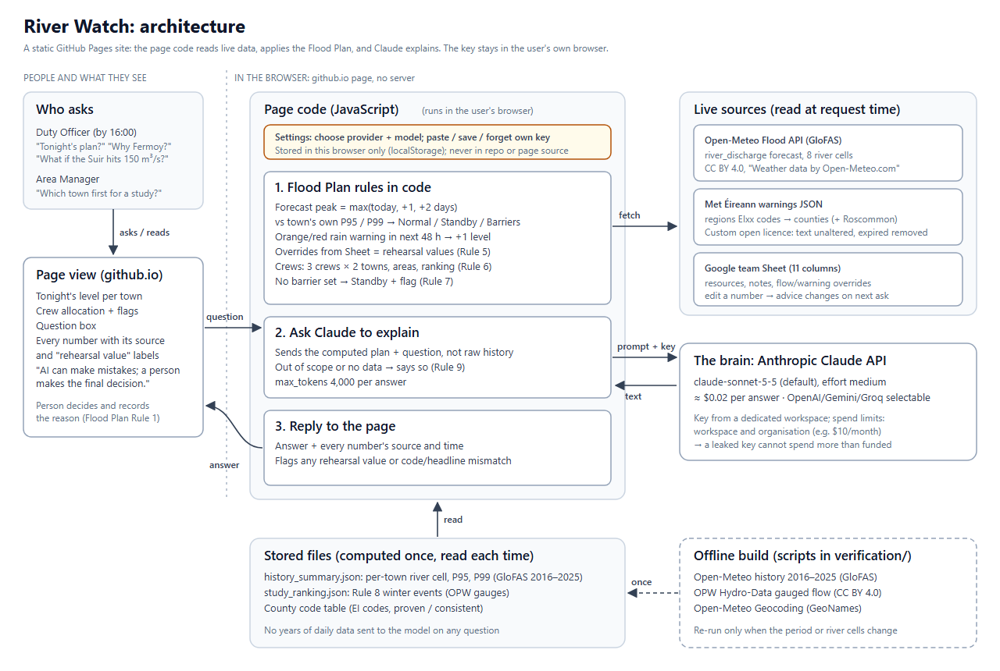

# River Watch architecture (Task 1)

Five-line version:

1. **Who asks:** the Duty Officer (tonight's plan by 16:00, "why", "what if") and the Area Manager (study ranking). They use a **static GitHub Pages site** (github.io) that shows every number with its source and date, labels rehearsal values, and states "AI can make mistakes; a person makes the final decision."
2. **The page code** runs in the user's browser; there is no server. When a question is asked, it reads the **Google team Sheet** live (CSV export: resources, notes, overrides), so editing a cell changes the next answer.
3. **Each source:** the page also reads live the **Open-Meteo Flood API (GloFAS)** forecast for 8 river cells and the **Met Éireann warnings** JSON (EI county codes). It reads stored files computed once offline: P95/P99 from GloFAS 2016–2025, and Rule 8 counts from **OPW** gauges. It then applies the Flood Plan rules in code. (OPW live levels are left out: that source blocks browser calls.)
4. **The brain:** the page sends the computed plan and the question, never raw history, to **Anthropic Claude Sonnet 5.5** (`claude-sonnet-5-5`, ≈ $0.02 per answer), the default; Settings also offers OpenAI, Gemini and Groq. Claude explains, reads notes and declines out-of-scope questions, and the Duty Officer makes and records the decision.
5. **The key:** each user pastes their own key into Settings (paste / save / forget), one per provider. It is kept only in that browser's `localStorage` and sent only to the chosen provider (default api.anthropic.com), never in the repository or the page source. **Limit:** the key comes from a dedicated Anthropic workspace with a spend limit (e.g. $10/month, plus the organisation limit), so a copied key cannot cost more than was funded.

Source files: `architecture.svg` (editable) and `architecture.png` (for the report). Hosting: GitHub Pages (static), no server-side component.
