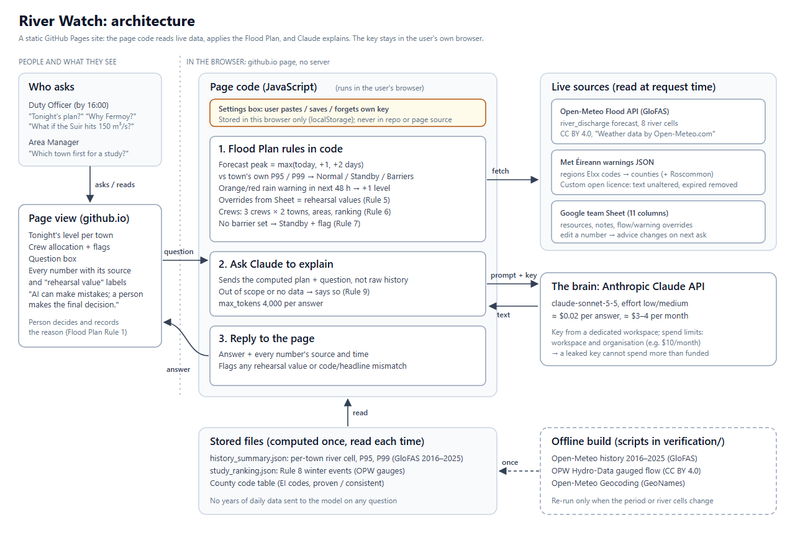

# Task 1: Find and check the data

All sources were found and checked on **26 Nov 2026**. Working notes and scripts are in `data_sources_verified.md` and `verification/` in the repository.

## 1. Sources, licences and the fields used

| Source | Publisher and address | Licence and attribution line | Fields used |
|---|---|---|---|
| River flow forecast (live) and 10-year history | Open-Meteo Flood API, data from GloFAS (Copernicus Emergency Management Service). `https://flood-api.open-meteo.com/v1/flood` | CC BY 4.0. "Weather data by Open-Meteo.com" (linked) and "Flood forecasts from Global Flood Awareness System GloFAS". | `daily.time`, `daily.river_discharge` (m³/s), `latitude`, `longitude` |
| Weather warnings (live) | Met Éireann. `https://www.met.ie/Open_Data/json/warning_IRELAND.json` (data.gov.ie "Weather Warnings") | Met Éireann Custom Open Data Licence (CC BY 4.0 plus conditions). "Copyright Met Éireann. Source: met.ie. This data is published under a Creative Commons Attribution 4.0 International (CC BY 4.0). Met Éireann does not accept any liability whatsoever for any error or omission in the data." | `type`, `level`, `status`, `onset`, `expiry`, `headline`, `regions` |
| Team Sheet (live) | Our Google Sheet, read as a CSV export at each question | Our own data | All 11 columns |
| Gauged river flow (check and Rule 8) | Office of Public Works, Hydro-Data. `https://waterlevel.ie/hydro-data/` | CC BY 4.0. "Contains Irish Public Sector Information licensed under a Creative Commons Attribution 4.0 International (CC BY 4.0) licence (source http://waterlevel.ie - provided by the Office of Public Works.)" | `Timestamp`, `Value` (m³/s), `Quality Code` |
| Town locations | Open-Meteo Geocoding API, data from GeoNames. `https://geocoding-api.open-meteo.com/v1/search` | CC BY 4.0. "Location data based on GeoNames". | `latitude`, `longitude`, `name`, `admin2` (county) |

| Source | Licence conditions that shaped the build | Changes made (CC BY asks us to say so) |
|---|---|---|
| Open-Meteo / GloFAS | Free API is non-commercial, 10,000 calls a day; Open-Meteo must be linked wherever the data is shown | Nearest main-river grid cell used, not the town point; P95/P99 computed from 2016–2025 |
| Met Éireann | Warning text must not be altered; expired warnings must be removed | Warnings filtered (rain, next 48 hours, county) but never edited |
| OPW | Data is provisional; derived work must refer to waterlevel.ie and its disclaimer | 15-minute flow averaged to daily means; days with fewer than 48 readings dropped |

All attribution lines are shown in the page footer.

## 2. Coordinates, and checking the flow belongs to each town's river

Each town was geocoded with the Open-Meteo Geocoding API, keeping only results whose name and county both matched ("Clonmel" also returns Clonmellon, Westmeath). The forecast is not read at the town point: there, **4 of the 8 towns fell on grid cells that are not the river**, with Fermoy, Bandon and Athlone under 1 m³/s. I scanned the 5 × 5 neighbouring GloFAS cells, chose the main-channel cell nearest each town, and compared its 2016–2025 daily flow with the nearest **OPW gauge on the same river**.

| Town | River | Town coordinates (geocoder) | River cell used (km from town) | OPW gauge on the same river | Gauge mean / GloFAS mean (m³/s) | Daily correlation r | Gauged flood days the model also flagged |
|---|---|---|---|---|---|---|---|
| Clonmel | Suir | 52.35500, −7.70389 | 52.375, −7.675 (3.0 km) | 16011 Clonmel | 50.3 / 33.3 | 0.85 | 89% |
| Fermoy | Blackwater | 52.13583, −8.27583 | 52.125, −8.225 (3.7 km) | 18107 Fermoy Br D/S | 46.8 / 32.4 | 0.79 | 79% |
| Mallow | Blackwater | 52.13333, −8.63333 | 52.125, −8.625 (1.1 km) | 18055 Mallow Railway Br | 35.0 / 18.5 | 0.74 | 79% |
| Bandon | Bandon | 51.74694, −8.74250 | 51.775, −8.725 (3.3 km) | 20002 Curranure | 17.5 / 8.2 | 0.76 | 87% |
| Enniscorthy | Slaney | 52.50083, −6.55778 | 52.475, −6.625 (5.4 km) | 12001 Scarawalsh | 23.8 / 17.0 | 0.81 | 87% |
| Ennis | Fergus | 52.84361, −8.98639 | 52.825, −9.025 (3.3 km) | 27002 Ballycorey | 12.0 / 13.0 | 0.83 | 89% |
| Athlone | Shannon | 53.42278, −7.93722 | 53.425, −7.975 (2.5 km) | 26027 Athlone | 106.0 / 76.1 | 0.82 | 100% |
| Carrick-on-Shannon | Shannon | 53.94694, −8.09000 | 53.925, −8.075 (2.6 km) | 26085 Jamestown (2019 on only) | 70.2 / 45.0 | 0.58 | 82% |

Every cell rises and falls with its own river's gauge. In 7 of 8 records the largest day matches a known flood: Storm Bert (24 Nov 2024), Storm Babet (19 Oct 2023), and the Shannon floods of winter 2015–16 and Feb 2020. GloFAS reads 30–50% lower than the gauges (Ennis excepted), so each town's thresholds come from its **own GloFAS history**, never from gauge levels. Carrick-on-Shannon is the weakest match.

## 3. History: period and the stored summary

**Period:** 1 Jan 2016 to 31 Dec 2025, 3,653 days per town, none missing. The summary is computed once and stored in `data/history_summary.json`; the tool never sends daily history to the model. Percentiles use linear interpolation.

| Town | River | River cell | Days | Mean m³/s | P95 m³/s | P99 m³/s | 10-year maximum (date) |
|---|---|---|---|---|---|---|---|
| Clonmel | Suir | 52.375, −7.675 | 3,653 | 33.1 | 77.7 | 127.7 | 291.4 (24 Nov 2024) |
| Fermoy | Blackwater | 52.125, −8.225 | 3,653 | 32.4 | 77.2 | 127.8 | 316.0 (24 Nov 2024) |
| Mallow | Blackwater | 52.125, −8.625 | 3,653 | 18.5 | 44.6 | 71.3 | 207.4 (24 Nov 2024) |
| Bandon | Bandon | 51.775, −8.725 | 3,653 | 8.2 | 22.0 | 38.7 | 99.7 (19 Oct 2023) |
| Enniscorthy | Slaney | 52.475, −6.625 | 3,653 | 17.1 | 38.7 | 69.8 | 144.2 (15 Nov 2025) |
| Ennis | Fergus | 52.825, −9.025 | 3,653 | 13.1 | 31.1 | 45.4 | 65.2 (24 Nov 2024) |
| Athlone | Shannon | 53.425, −7.975 | 3,653 | 76.2 | 142.4 | 186.7 | 254.3 (6 Jan 2016) |
| Carrick-on-Shannon | Shannon | 53.925, −8.075 | 3,653 | 27.4 | 62.2 | 88.8 | 133.6 (10 Feb 2020) |

Rule 8 uses measured **OPW gauge** flow (`data/study_ranking.json`), because the GloFAS event counts failed the gauge check (Ennis: 17 events in GloFAS, 3 on the gauge).

| Town | Source | P99 m³/s | High-flow events, winters 2016/17–2024/25 | First 4 / last 4 winters |
|---|---|---|---|---|
| Fermoy | OPW 18107 | 254.1 | **22** | 9 / 9 |
| Mallow | OPW 18055 | 197.5 | 21 | 8 / 9 |
| Bandon | OPW 20002 | 90.9 | 19 | 4 / 9 |
| Enniscorthy | OPW 12001 | 100.5 | 13 | 5 / 5 |
| Clonmel | OPW 16011 | 195.7 | 12 | 7 / 3 |
| Ennis | OPW 27002 | 41.7 | 3 | 2 / 1 |
| Athlone | OPW 26027 | 303.6 | 1 | 1 / 0 |
| Carrick-on-Shannon | GloFAS (low confidence) | 88.8 | 12 | 4 / 3 |

## 4. Warnings: how the source names counties, and how the tool matches them

Met Éireann names counties by code (`regions` EI01–EI31; EI8xx are sea areas) and publishes no code table. I matched the code lists in Met Éireann's own example warnings against the county names in their headlines. Two of the codes River Watch needs are proven this way; the rest fit every warning seen and the alphabetical FIPS 10-4 pattern, so the tool also cross-checks each match against the headline.

| County needed | Town(s) | Code | Status |
|---|---|---|---|
| Tipperary | Clonmel | EI26 | consistent with all evidence |
| Cork | Fermoy, Mallow, Bandon | EI04 | consistent with all evidence |
| Wexford | Enniscorthy | EI30 | consistent with all evidence |
| Clare | Ennis | EI03 | **proven** |
| Westmeath | Athlone | EI29 | consistent with all evidence |
| Roscommon | Athlone, Carrick-on-Shannon (from the notes) | EI24 | **proven** |
| Leitrim | Carrick-on-Shannon | EI14 | consistent with all evidence |

| Flood Plan Rule 4 check | How the tool applies it |
|---|---|
| Rain warnings only | Counts if `type` **or** `headline` says rain. Met Éireann's own "Rain and Low Temperature" example has `type: "low-temperature"`, so `type` alone would miss it. |
| Orange or red raises one level | Yellow is shown but changes nothing; advisories are ignored; Barriers stays Barriers |
| In force in the next 48 hours | Onset ≤ now + 48 h and expiry later than now; expired warnings removed |
| Towns spanning two counties | The county column plus any county named in the notes (Athlone and Carrick-on-Shannon also count Roscommon) |
| Code cross-check | Each code match is compared with the counties named in the headline ("Connacht" and "Ireland" expanded); disagreements are shown, not guessed |
| Rehearsal values (Rule 5) | `warning_override` "orange" or "red" (any case) acts as a live warning, labelled as a rehearsal value |

## 5. The AI brain

| Item | Answer |
|---|---|
| Provider, model and tier | Anthropic Claude API, **Claude Sonnet 5.5** (`claude-sonnet-5-5`), standard global routing, Start usage tier. Settings also offers OpenAI, Google Gemini and Groq. |
| Price per answer | **≈ $0.02** from Anthropic's pricing page, checked **26 Nov 2026** ($2 per million input tokens, $10 per million output; about 4,000 in and 1,500 out). Task 3 measured $0.023–0.027. |
| Where the key lives | Pasted by each user into the page's Settings box (paste, save, forget), kept only in that browser's `localStorage`, and sent only to the chosen provider. **Never** in the repository, the page source or the Sheet. |
| What limit stops a leak | The key is created in a **dedicated River Watch workspace** with a **monthly spend limit** (e.g. $10), and there is an organisation spend limit as a second ceiling: Anthropic stops requests at the limit. `max_tokens: 4000` caps one answer at about $0.05. A leaked key is revoked and replaced. |

**Why this level of brain fits:** code computes every level, crew place and flag, so the brain only explains them, reads free-text notes (such as the Mallow crew restriction), re-runs the plan for "what if" questions and declines out-of-scope ones. A mid-tier model does this reliably. Opus 5.5 costs twice as much for reasoning the code already does, and Haiku 5.5 is more likely to misread a note.

## 6. Architecture

